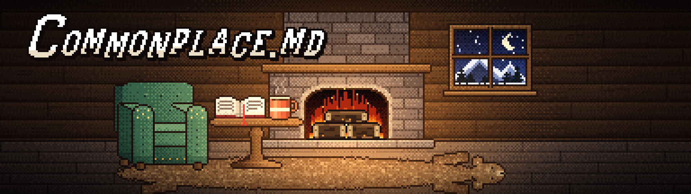
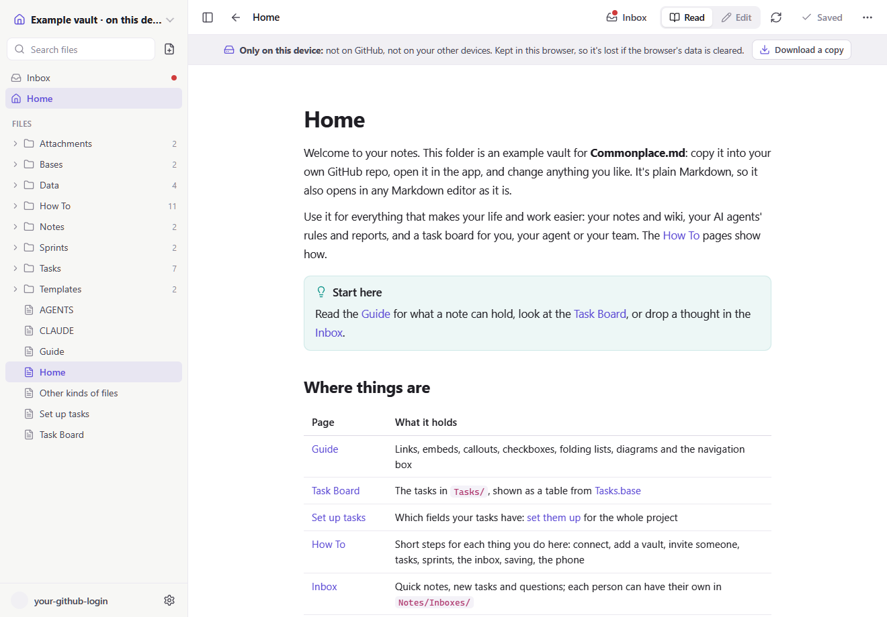

**A common place for your everyday: your project's wiki, notes and task board, your private notes and recipes, all in your own GitHub repo, for free.**

**[Open Commonplace.md](https://snowy-peak-studios.github.io/commonplace-md/)** · [Roadmap](ROADMAP.md) · [Support us on Ko-fi](https://ko-fi.com/jansnieg)

*Don't rely on your agent's memory: make your own vault with all the answers.*

## What it is

**Commonplace.md** brings your wiki, notes and task board together as plain Markdown files you own. Keep them in a local vault on one device, or in your own GitHub repo for a team and multiple devices. It runs in your browser and can be installed as an app.

- **Notes that stay yours:** linked pages, pictures, checklists, diagrams and tables.
- **Tasks alongside the context:** boards, subtasks, relations, sprints and fields you choose.
- **People and AI agents together:** your inbox, project rules and decisions live in the same files.
- **Free and open source:** no server or account of ours. GitHub saves are commits; local notes stay on your device.

## A look inside

<picture>
  <source media="(prefers-color-scheme: dark)" srcset="docs/images/screenshots/notes-dark.png">
  <source media="(prefers-color-scheme: light)" srcset="docs/images/screenshots/notes-light.png">
  
</picture>

[See the task board, task details and phone layouts](docs/gallery.md).

## Quick start

1. **[Open the app](https://snowy-peak-studios.github.io/commonplace-md/)** and choose **Add a vault on this device**.
2. **Pick an example vault** to try the features, or start empty. No GitHub account or token is needed for a local vault.
3. **Write and save.** In Chrome or Edge on a computer, you can keep real files in a folder. For a browser-only vault, use **Download a copy** regularly: clearing browser data removes its notes.

**For a team or several devices:** [connect your own GitHub repo](docs/getting-started.md#set-it-up-with-github). Each device gets a token you make; your repo controls who can read and save.

[Full setup guide](docs/getting-started.md) · [Install it as an app](docs/getting-started.md#5-install-it-as-an-app-optional) · [Ask an agent to help you choose](docs/using-commonplace.md#not-sure-its-for-you)

## Guides

| Looking for… | Read |
| --- | --- |
| How to use it and what it does | [Usage and features](docs/using-commonplace.md) · [Short how-to pages](example-vault/How%20To/How%20To.md) |
| Every block, its options and examples | [Block reference](docs/blocks.md) |
| Markdown, links and supported file features | [Markdown examples](docs/markdown-and-blocks.md) · [Markdown support](docs/markdown-support.md) |
| Repo settings, task fields and sprints | [Settings reference](docs/settings.md) |
| Starter vaults and the feature-guide files | [Example vaults](docs/example-vaults.md) |
| Team access, invite links and inboxes | [Sharing and inboxes](docs/collaboration.md) |
| Agent setup, rules and skills | [Working with AI agents](docs/ai-agents.md) |
| Tokens, local storage and network access | [Privacy and security](docs/privacy.md) |
| Running locally, tests and code layout | [Contributing](docs/contributing.md) |

## License

MIT: see [LICENSE](LICENSE) and the [third-party licenses](vendor/LICENSES.md).

The logo (`icons/`), banner (`docs/images/banner.png`) and illustrations (`docs/images/illustrations/`) belong to Snowy Peak Studios, all rights reserved. Documentation screenshots and the annotated browser capture are under the repository's MIT license.
