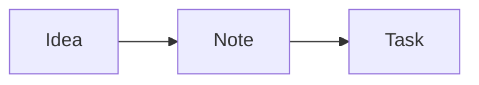

# Block reference

[README](../README.md) · [Markdown basics and live examples](markdown-and-blocks.md)

Blocks turn a part of a Markdown note into a view, a capture box or a named section. Write three backticks, the block name, its contents, and a closing line of three backticks. In Commonplace.md, switch to **Read** to use it. On GitHub and in other Markdown readers, app-specific blocks show their source.

In **Edit**, **Insert** above the editor lists every block here, with a preview of how it looks, and adds it at the cursor. Block names are case insensitive. Put app blocks directly in the note; views inside an embedded page may keep their source instead of becoming interactive. Task and sprint views need the project's task settings and matching notes. Being able to see a view does not grant permission to change its files.

| Block | What it shows |
| --- | --- |
| [top-tasks](#top-tasks) | Tasks to work on and Claim |
| [needs-attention](#needs-attention) | Reviews, questions, mentions and assignments |
| [new-tasks](#new-tasks) | Ideas for a person's agent to sort |
| [inbox-overview](#inbox-overview) | A private overview of selected inboxes |
| [subtasks](#subtasks) | A task's children and progress |
| [relations](#relations) | Links between tasks |
| [commits](#commits) | A task's saved commit links |
| [assets](#assets) | The files and assets a task expects to occupy |
| [occupied](#occupied) | The assets tasks in progress occupy now, and overlaps |
| [sprint](#sprint) | A sprint's progress and tasks |
| [board](#board) | Task cards in status columns |
| [ai-work-time](#ai-work-time) | Recorded AI work time grouped as a chart |
| [base](#base) | Tables with filters, formulas and views |
| [toc](#toc) | The page's headings, as links |
| [subpages](#subpages) | The pages under this one, from their `parent` property |
| [mermaid](#mermaid) | A diagram written as text |
| [description](#description), [acceptance-criteria](#acceptance-criteria), [comments](#comments), [work-history](#work-history) | Named sections containing Markdown |

## top-tasks

Shows the work queue, including tasks already claimed for the person and free tasks they can start. **Claim** assigns a free task to the block's owner. Questions, placeholders, dependencies and postponed tasks affect which work is ready. Reviews belong in `needs-attention`.

```top-tasks
range: 3
areas: Features, Docs
order: priority-oldest
sprint: current-only
owner: Your name
fields: parent, state, priority, area
```

| Option | Values and default |
| --- | --- |
| `range` | Number of free suggestions, clamped to 1–20. Default: 3. Older blocks may use `count`. Claimed tasks can make the box longer. |
| `areas` | Comma-separated areas, optionally in brackets. Empty or omitted: any area. |
| `order` | `priority-newest`, `priority-oldest`, `newest`, `oldest`. Default: `priority-newest`. Priority orders put the highest priority first; the second word breaks ties. |
| `sprint` | `current-only`, `current-then-next`, `off`. Default: `off`. The second option uses the next sprint when the current one has no work left. |
| `owner` | The person Claim assigns work to. Required for claiming: with no owner, nothing can be claimed. There is no fallback to the page's owner or signed-in user. |
| `fields` | Comma-separated detail names, in display order. Default: `state, priority, area`. `parent` shows the parent task and `state` shows readiness; other names select task fields or properties. An empty `fields:` line shows no extra details. Name and Claim always remain. |

The box indicates when range, order or fields use defaults. Options belong in the block, rather than in the page's front matter. See [Use your inbox](../example-vault/How%20To/Use%20your%20inbox.md#tasks-for-today) for queue actions.

## needs-attention

Shows items that wait on a person. Reviews appear first when selected; they remain until the task leaves its review status. Questions come from task `question` properties. Mentions use a GitHub login. Seen can dismiss mentions and assignments, but cannot approve a review.

```needs-attention
show: reviews, questions, mentions, assignments
review-statuses: Testing
owner: Your name
login: your-github-login
```

| Option | Values and default |
| --- | --- |
| `show` | Any comma-separated selection of `reviews`, `questions`, `mentions`, `assignments`; `all` selects all four. Default: `questions, mentions`. `both` also means questions and mentions. Singular names are accepted. |
| `review-statuses` | Comma-separated statuses to review. Default: `Testing`. Used when `reviews` is selected. A declared reviewer takes precedence over the assignee; the assignee is the fallback. |
| `owner` | The person's name for questions, reviews and assignments. Write it explicitly; it is separate from `login`. |
| `login` | GitHub login for mentions, with or without `@`. Omitted or empty: no mention identity. |

No owner identity is inferred from the page's `owner` property. A missing or unrecognised `show` uses the default selection.

## new-tasks

To include context, put the cursor on the intended idea in the multiline box and paste an image or file when the clipboard provides file data, or choose **Attach file** (desktop and phone). The file is saved in this vault's Attachments folder, or beside the inbox when none is configured. Its Markdown link is added to that line; pictures have a preview and other files keep a readable filename. Add or keep changes, then Save the note to keep the link. Files are limited to 10 MiB. A failed upload keeps your text and offers **Retry attachment**. When an agent turns the idea into a task, it carries the link into the new task note; the attachment stays in the vault after the capture is cleared.

Captures ideas on any page. Use the multiline box to write or paste several ideas, one per line (bullets are optional), then press **Add**. **Enter** adds a line. **Edit list** puts all items in the same box so you can revise or delete several at once; each item also has Edit and Remove. Choose **Keep changes**, then **Save** the note. The block keeps its `owner:` line, and agents still read one idea per Markdown list item. Your agent turns them into task notes according to your vault's rules. The block itself does not create or assign task notes.

```new-tasks
owner: Your name
- Add a reading list
- Write a short setup guide
```

`owner` is the only setting. It names the person whose agent sorts these items; it does not fall back to the page's owner. With no owner, the box says that no agent sorts it. Write one item per line; use `- ` for clarity. The contents are capture text, not a YAML task definition. Images or attachment links may be part of an item.

## inbox-overview

Combines selected inboxes for reading in a private dashboard. It runs only in the private browser-local note selected in **Settings → This device → Set up inbox overview**. A shared note or an embed cannot run it. Use that setup screen to create source bindings; the example below has none and reads nothing.

```inbox-overview
context: My inbox
show: [reviews, questions, assignments, mentions, new-tasks]
review-statuses: [Testing]
refresh: manual
limit: 50
sources: []
```

| Option | Values and default |
| --- | --- |
| `context` | Display name. Default: `My inbox`. |
| `show` | Non-empty list of `reviews`, `questions`, `assignments`, `mentions`, `new-tasks`. Default: all five. |
| `review-statuses` | Non-empty list of review statuses. Default: `[Testing]`. |
| `refresh` | Only `manual` is supported; also the default. Opening the selected dashboard reads sources; **Refresh selected vaults** reads them again. |
| `limit` | Whole number from 1 to 200. Default: 50. |
| `sources` | Up to 50 explicit, distinct source bindings. Default: `[]`. No automatic discovery. |

Each source is a YAML mapping:

| Source property | Meaning |
| --- | --- |
| `kind` | Required: `github`, `browser` or `folder`. |
| `inbox` | Required: exact relative path to the inbox Markdown file, inside the vault. |
| `person` | Required: the person's name in that vault. |
| `login` | Optional: GitHub login for mentions, with or without `@`. |
| `owner`, `repo`, `branch` | Required for GitHub sources. Exact repository owner, name and branch. |
| `folder` | Optional for GitHub: vault folder within the repository, empty for its root. |
| `vault` | Required for browser/folder sources: the existing local vault ID on this device. |

Bindings must match a vault already configured on the device. Paths cannot be absolute, use parent steps or include dot folders. Unsupported options, invalid limits and duplicate sources are rejected. Do not put tokens in a block. Keep real source bindings in the private dashboard; back it up and configure it separately on each device. Open a row to act in its source vault. [Overview setup and access states](../example-vault/How%20To/Use%20your%20inbox.md#one-overview-of-selected-inboxes).

## subtasks

Shows a task's child tasks, statuses and progress. On the task's own page, **Add subtask** is available when the project and permissions allow it.

```subtasks
```

The optional `task` property selects another task by name, ID or wikilink. On another page the view is for reading; make changes on the task itself.

```subtasks
task: Get set up
```

Default: the current task. The project's parent-task field defines the relationship. Outside a task, an empty block keeps its source; a view with no content on its own task may be hidden.

## relations

Shows a task's links to other tasks and the links back to it. Relations include blocked by, related to, comes after and comes before; the relevant fields must be enabled in the project's task settings.

```relations
task: Add a reading list
```

The only applicable option is `task`: a name, ID or wikilink. Default: the current task. Leave the block empty on its own task page. Views of other tasks are for reading; edit relations on the task itself. An empty block outside a task keeps its source.

## commits

Shows the entries saved in a task's `commits` property, as links. It does not search Git history or populate that property by itself. The optional [Task commits Action](../tools/task-commits/task-commits.yml) can fill it from commit messages.

```commits
task: Get set up
```

The only applicable option is `task`: a name, ID or wikilink. Default: the current task. Leave the block empty on its own task page. A task with this block shows commits here instead of repeating them in its properties box.

## assets

Lists the files and assets a task expects to occupy: the plan, written before the work by the person or the agent. One path per line, from the repo's root; a folder ends with `/`; a note can follow after ` # `. A line starting with `#` is a comment.

```assets
Source/Game/Player.cpp # movement
Content/Maps/Level 1.umap
Content/Characters/
```

On its task page it shows as *Occupied assets*: a file in the vault links to its page, and in a GitHub vault any other path links to the file on GitHub. What the task really changed is in its [commits](#commits). When the paths are in another GitHub repo than the vault's, for example a vault of notes about an app whose code lives elsewhere, start the block with `repo: owner/name` (and `branch: dev` for a branch other than its default): the paths then link to that repo. On a page that isn't a task the block stays as code. New tasks don't get this block by themselves: add it where it helps, for example for game engine assets two tasks shouldn't change at once.

## occupied

Lists the assets that tasks in progress occupy now, from their [assets](#assets) blocks, with the tasks on each. Where two or more tasks plan to change the same file (in any case), or a file inside a folder another task lists, the row shows a warning. Put it on a board or a home page.

```occupied
show: conflicts
```

| Option | Values and default |
| --- | --- |
| `show` | `conflicts` lists only the assets more than one task occupies. Default: every occupied asset. |

A task occupies its assets while it's in progress (its status is In Progress, or in a project without that status its second one, like Doing), or while it's claimed (it has an assignee) and not in review (Testing), put off (Waiting) or finished. So a task claimed for an agent that hasn't started yet counts. Handing it to Testing, unclaiming it, putting it off with **Not now** or finishing it frees them, and editing its block changes them: the list is worked out from the saved tasks each time. Paths in different repos (a `repo:` line) never overlap. The same warning shows on a task's *Occupied assets* box and in the **Claim** dialog. It's a warning, not a lock: nothing stops a save.

## sprint

Shows a sprint's goal, dates, progress and tasks grouped by status. Under the tasks' bar, a second bar in another colour shows how much of the sprint's time is gone ("Day 6 of 14 · 9 days left"), so the two can be compared. On its own sprint page, leave the block empty:

```sprint
```

The optional `sprint` property selects `current`, `next`, a sprint name or a wikilink. Default: the current sprint note, not the current date's sprint. A named sprint remains available after its dates pass.

```sprint
sprint: Sprint 1
```

To show only how the sprint is going, for example above the top tasks in an inbox, add `show: progress`. It keeps the head, the goal and the two bars (tasks done and time gone) and leaves out the task list. `owner` adds a line with that person's share of the sprint (tasks assigned to them or to their agent), and `login` also counts tasks assigned to their GitHub login:

```sprint
sprint: current
show: progress
owner: Your name
login: your-github-login
```

| Option | Values and default |
| --- | --- |
| `sprint` | `current`, `next`, a sprint name or wikilink. Default: the sprint page the block is on. |
| `show` | `progress` for the head, goal and progress bar only. Default: everything, with the tasks by status. |
| `owner` | A person's name: adds their share of the sprint. Default: no share line. |
| `login` | A GitHub login, with or without `@`: counted as that person too. |

With no sprint going on today, a `sprint: current` block says so. Sprints and the task sprint field must be enabled and configured for the project. A block targeting another sprint is for reading. [Sprint setup](../example-vault/How%20To/Run%20sprints.md).

## board

Shows task cards in one column per status. Drag a card or use its status control to move it when you have write permission. Cards and the table views share the same task files.

```board
columns: To Do, In Progress, Testing, Done
areas: Features, Docs
type: Story, Bug
assignee: Your name
sprint: current
```

| Option | Values and default |
| --- | --- |
| `columns` | Comma-separated statuses, in display order. Default: all statuses from the project's status field. |
| `areas` | Comma-separated areas. Empty or omitted: any area. |
| `type` | Comma-separated task types. Empty or omitted: any type. |
| `assignee` | One assignee to filter by. Empty or omitted: anyone. |
| `sprint` | `current`, `next`, a sprint name or wikilink. Empty or omitted: any sprint. |

All supplied filters apply together. Put this block directly in a note, outside embeds. Column and filter lists are comma-separated text, not YAML bracket lists. Leave out filters you do not need.

## ai-work-time

Charts the average AI work time, sample count and observed range from completed tasks in this vault. `work_time` is whole, non-negative AI minutes. It is never a measure of human work and does not promise a finish time. Invalid values, cancelled tasks and epics are excluded.

```ai-work-time
group: area-type
```

The only supported setting is `group`: `area-type` (default), `area` or `type`. Tasks need the corresponding grouping properties and valid AI time records. The block uses the project's task settings and stays inert in embedded pages.

## toc

Lists the page's headings, each a link to its place, nested as they are on the page. It follows the page as its headings change. The page's title (`#`) is left out.

```toc
depth: 3
```

`depth` is the smallest heading it shows: `2` for `##` only, up to `6`. Without it, `##` and `###` show. Only headings directly in the page are listed, not those inside callouts or embedded pages.

## subpages

Lists the pages whose `parent` property leads to this page, as links. A page's `description` property shows after its name, as one line of Markdown. It follows the pages as they change.

```subpages
depth: 2
page: "[[Guides]]"
```

| Setting | Default | Use |
| --- | --- | --- |
| `depth` | `1` | How many levels of pages: `1` to `3`. Deeper pages nest under their parents. |
| `page` | This page | Another page's name or link, to list its subpages instead. |

Pages with an `order` number come first, smallest first; the rest follow by name. The project's tasks aren't listed; the task board shows them. A page shows once, even when parents loop. The block stays as its source in embedded pages.

## base

Draws the same table views as a `.base` file, with the view's YAML stored in the note. Use `![[Bases/Tasks.base]]` instead when several notes should share one file. Only table views are supported.

```base
filters: 'file.inFolder("Tasks")'
formulas:
  rank: 'if(priority == "High", 1, 2)'
properties:
  file.name:
    displayName: Task
views:
  - type: table
    name: Tasks
    filters: 'status != "Done"'
    groupBy:
      property: status
      direction: ASC
    order: [file.name, status, priority]
    sort:
      - property: formula.rank
        direction: ASC
    columnSize:
      file.name: 260
    limit: 20
```

| Property | Meaning and default |
| --- | --- |
| `filters` | Optional filter for all views. A string expression, or nested `and`, `or`, `not` filters. Omitted: no global filter. |
| `formulas` | Mapping of names to expressions. Refer to a result as `formula.name`. Default: none. |
| `properties` | Mapping of column keys to settings. `displayName` sets the label. Default: the column key. |
| `views` | List of view mappings, shown as tabs. Provide at least one to get a table. |
| `views[].type` | `table` (default). Other types are unsupported. |
| `views[].name` | Tab name. Default: `View 1`, `View 2`, and so on. |
| `views[].filters` | Additional filter for this view, combined with the global filter. Default: none. |
| `views[].groupBy` | Mapping with `property` and optional `direction` (`ASC` or `DESC`, default `ASC`). Default: no grouping. |
| `views[].order` | List of column keys, in display order. Default: `[file.name]`. |
| `views[].sort` | List of mappings with `property` and `direction` (`ASC` or `DESC`, default `ASC`). Default: no explicit sort. |
| `views[].columnSize` | Mapping of column keys to positive widths in pixels. Default: automatic widths. |
| `views[].limit` | Positive maximum row count. Default: no limit. |

Column keys can be note properties such as `status` (or `note.status`), file properties such as `file.name`, or `formula.rank`. Expressions support comparisons, arithmetic, `&&`, `||`, `!`, `if()`, `today()`, `date()`, and methods including `file.inFolder()`, `file.hasTag()`, `.contains()`, `.startsWith()`, `.endsWith()`, `.lower()` and `.isEmpty()`. Unsupported expressions show an error rather than silently drawing a wrong table. See [example base files](../example-vault/Bases/Tasks.base).

## mermaid

Draws a diagram from Mermaid text, using the device's light or dark theme.



No Commonplace.md option lines are added: the contents are Mermaid diagram syntax. `flowchart LR` means left to right, and `-->` draws an arrow. Other diagram types use Mermaid's own syntax.

## description

A named **Description** section containing Markdown, not configuration options. Use it for the story or explanation.

```description
Keep the project's notes and decisions together.
```

No block properties or defaults. Place the fence directly in the note, not inside another section or list.

## acceptance-criteria

A named **Acceptance Criteria** section. Its contents are Markdown; checkboxes can be ticked in Read mode when the note can be saved.

```acceptance-criteria
- [ ] The setup guide opens from Home.
- [ ] A new person can follow the steps.
```

No block properties or defaults. Place it directly in the note.

## comments

A named **Comments** section on any note. In Read mode, a writable note offers a comment form here. New comments are saved with a dated header and the author's identity. The previous commenter's mention can be filled in when their login is known and differs from yours.

```comments
```

No option lines. Leave it empty to start a discussion, or keep existing Markdown comments inside. [Comment format and examples](../example-vault/How%20To/Work%20with%20tasks.md#task-sections).

## work-history

A named **Work History** section for Markdown log entries. It starts folded and is displayed at the bottom of the note, even if its fence was written earlier. It does not measure time or generate entries by itself.

```work-history
- Checked the guide's links and examples.
```

No option lines or automatic entries. Put the fence directly in the note. For all four named sections, keep one of each, with `work-history` last, to make notes easy to edit in other tools too. [Task section examples](../example-vault/How%20To/Work%20with%20tasks.md#task-sections).
