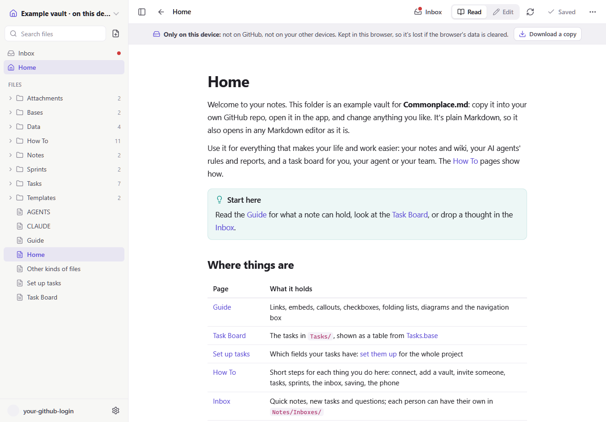
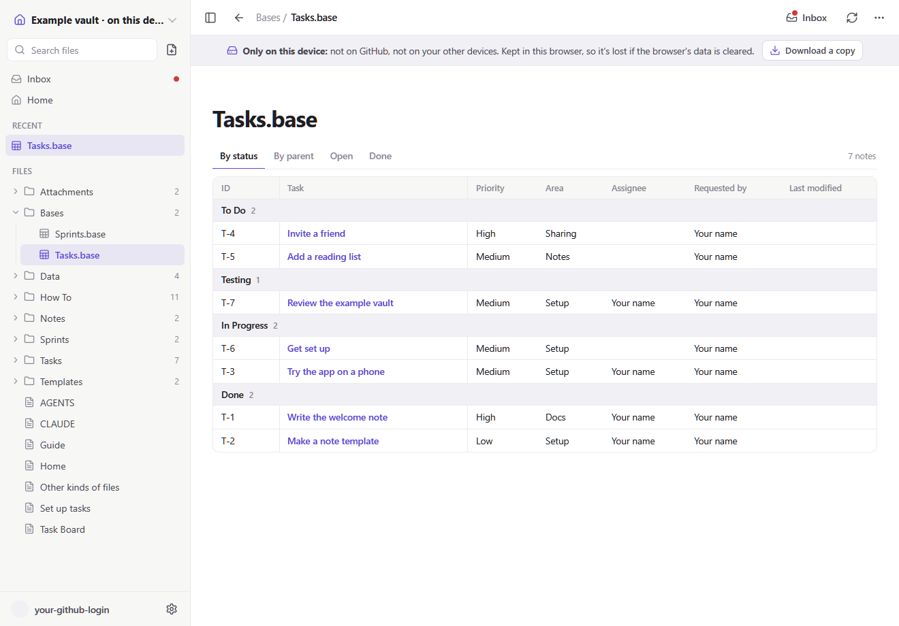
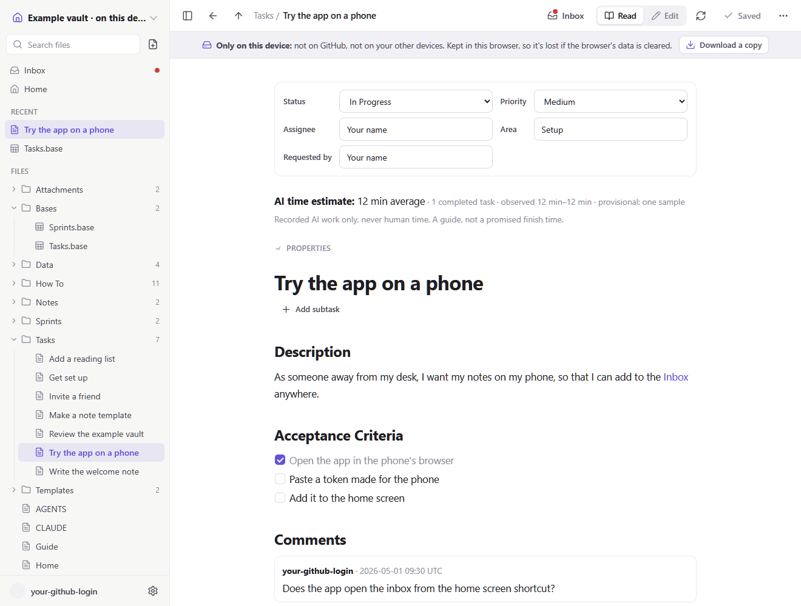
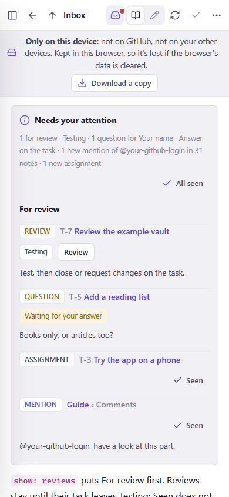
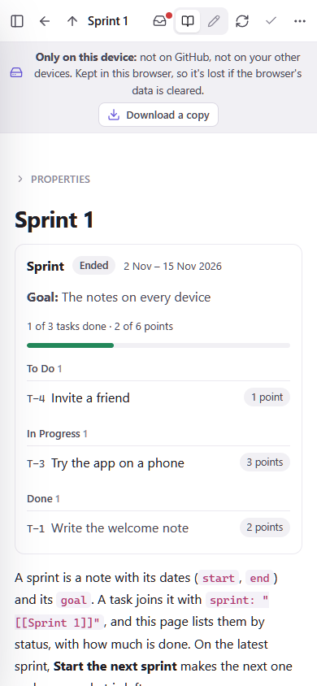

# A look inside

[README](../README.md) · [Getting started](getting-started.md) · [Block reference](blocks.md)

The public example vault, opened in Commonplace.md. Screenshots follow your device's light or dark theme; open an image for a closer look.

<picture>
  <source media="(prefers-color-scheme: dark)" srcset="images/screenshots/notes-dark.png">
  <source media="(prefers-color-scheme: light)" srcset="images/screenshots/notes-light.png">
  
</picture>

*A home for your notes: folders on the left, readable Markdown and links on the right.*

### One table for the whole project

<picture>
  <source media="(prefers-color-scheme: dark)" srcset="images/screenshots/task-board-dark.png">
  <source media="(prefers-color-scheme: light)" srcset="images/screenshots/task-board-light.png">
  
</picture>

*Tasks are notes. The table groups and filters their saved fields.*

### Enough context to finish a task

<picture>
  <source media="(prefers-color-scheme: dark)" srcset="images/screenshots/task-dark.png">
  <source media="(prefers-color-scheme: light)" srcset="images/screenshots/task-light.png">
  
</picture>

*Keep the description, checklist and discussion together.*

### Away from your desk

#### Your inbox

<picture>
  <source media="(prefers-color-scheme: dark)" srcset="images/screenshots/inbox-phone-dark.png">
  <source media="(prefers-color-scheme: light)" srcset="images/screenshots/inbox-phone-light.png">
  
</picture>

*Reviews, questions and mentions in one place.*

#### A sprint

<picture>
  <source media="(prefers-color-scheme: dark)" srcset="images/screenshots/sprint-phone-dark.png">
  <source media="(prefers-color-scheme: light)" srcset="images/screenshots/sprint-phone-light.png">
  
</picture>

*The sprint's goal and tasks, grouped by status.*

These captures use the included feature-guide vault, kept in the browser without a token. The local-only banner is part of that mode; a connected GitHub vault uses the same note and task views.
