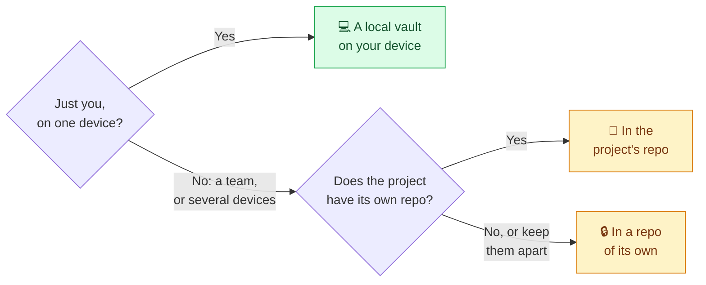
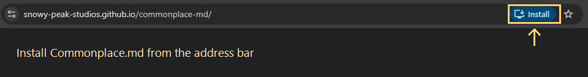

# Getting started

[README](../README.md) · [Getting started](getting-started.md) · [Block reference](blocks.md)

## Quick start

### Which way fits you

The app is the same for everyone. What you pick is where your vault lives:



| Way | Good for | But |
| --- | --- | --- |
| 🟩 **A local vault** ([steps](#a-local-vault)) | No GitHub account, no token: only the app. | Only on that one device. In Firefox, Safari and on phones it's kept in the browser, and lost if the browser's data is cleared. |
| 🟨 **In the project's repo** ([steps](#2-make-a-notes-repo)) | Notes next to the code; your agent sees both. | Whoever sees the code sees the notes. |
| 🟨 **In a repo of its own** ([steps](#1-open-the-app)) | Private notes, even for a public project. | One more repo to make. |

> [!NOTE]
> **No GitHub account?** A [local vault](#a-local-vault) doesn't need one; the other ways do. **Your own copy of the app?** Not needed: you can [host one](#1-open-the-app), but it won't update by itself.

### A local vault

Notes only on this device: not on GitHub, not on your other devices. No account and no token.

1. Open the app. On the first page press **Add a vault on this device** (or later: **Settings › Notes repos › Add a vault on this device**).
2. Pick one (Chrome and Edge on a computer; in Brave, first turn on `brave://flags/#file-system-access-api` and restart it, since Brave keeps opening folders off):
   - **Create a new vault**: a name, a location you pick (**Pick a location**), and what it starts with (empty, or one of the [example vaults](example-vaults.md#pick-a-starter-vault)). The app makes a new folder with the vault's name inside that location.
   - **Open a folder as a vault**: pick any folder of Markdown notes (**Pick the folder**), like another app's vault or a repo's clone. It opens as it is, with nothing added.
3. Either way the notes are real `.md` files, so your agent and other Markdown editors can read and change them, and **Reload** shows their changes. Each time the browser is opened again, it asks once before it lets the app into the folder. The browser shows the app only the folder's name, not its whole path.

A new vault can also be kept **in this browser** instead of a folder (and always is in Firefox, Safari, on phones, and in Brave until it's turned on, which can't open a folder): the notes are kept in the browser's storage. They're lost if the browser's data is cleared, so press **Download a copy** now and then (a zip of every note).

**Save** saves on the device; nothing is sent anywhere. A local vault always says so, in the list of vaults (*on this device*) and in a line above the note.

### A copy on this device

Every vault on GitHub is also kept on the device you open it on, so it opens with no connection, on a train or when GitHub is down. A line above the note then says you're reading the copy, and from when. GitHub keeps the main copy.

- **Where:** in the browser by default. In Chrome and Edge on a computer, the repo's card in **Settings** has **Keep it in a folder**: pick the repo's own folder (its clone, the one with `.git`) or an empty one. The notes are then real files that other Markdown editors and your agent read, and each commit (yours or anyone's) updates them when the vault opens or reloads.
- **Changed on the disk:** a file changed there by another tool shows as it is, marked **Not on GitHub**, and is never overwritten by GitHub's version. It's uploaded only when you press **Upload** (Save, on that note) or **Upload** in **Settings › This device**, which lists everything that waits.
- **A clone:** the app commits through GitHub, so your clone's git sees the app's saves as changed files until it pulls. Pull with `git pull --rebase --autostash`; a plain `git pull` can stop.
- **Saving offline:** Save keeps the note in the copy, marked **Waiting to upload** (a dot in the file list, and a count above the note). When the connection is back (or you press **Upload now**), each waiting save goes to GitHub as its own commit, the oldest first. If the note changed on GitHub meanwhile, GitHub refuses it and the app shows both versions to pick or merge; if it was deleted there, it offers **Save it as a new note**. Nothing waiting is dropped, but it's only on this device until it's uploaded.
- **Only what's needed:** each open asks GitHub for the list of files (one request) and downloads only the ones that changed. Images and PDFs are kept once you open them.

### Set it up with GitHub

> [!TIP]
> Not sure yet? [Ask your agent first](using-commonplace.md#not-sure-its-for-you). Looking for one thing? The [How To](../example-vault/How%20To/How%20To.md) pages have short steps for each, and they open in the app too. See [Markdown and blocks](markdown-and-blocks.md) for syntax and live examples.

Five steps, about ten minutes. Or let your AI agent do most of them:

```text
Set up Commonplace.md for me: a notes app that reads and edits Markdown notes kept in a GitHub repo,
at https://snowy-peak-studios.github.io/commonplace-md/ (code: https://github.com/Snowy-Peak-Studios/commonplace-md).

1. Ask me for my name, my GitHub login, and where the notes go: a new repo, or a repo I already have.
   - A new repo: ask for its GitHub owner (my user name or an organization) and its name (default "notes").
     The notes go at the top of the repo, on the branch main.
   - A repo I already have (for example a project's own repo): ask for <owner>/<repo> and the folder for
     the notes in it (default "notes"; empty means the top of the repo). If the repo is public, tell me my
     notes would be public too, and ask before going on.
2. The repo:
   - New: make it private, with the GitHub CLI if it's installed and signed in
     (gh repo create <owner>/<repo> --private), otherwise ask me to make an empty private repo
     at https://github.com/new and wait for me. Then clone it.
   - Existing: clone it. Its branch is the one the clone is on (its default branch), unless I name another.
     Check that I can push to it: with the GitHub CLI, gh repo view <owner>/<repo> --json viewerPermission
     says WRITE, MAINTAIN or ADMIN; otherwise git push --dry-run works. If I can't, stop and tell me.
3. Fill it with the example vault:
   git clone --depth 1 --filter=blob:none --sparse https://github.com/Snowy-Peak-Studios/commonplace-md.git
   git -C commonplace-md sparse-checkout set example-vault
   Copy everything inside commonplace-md/example-vault/ (folders, the hidden .agents and .claude folders, and
   the AGENTS.md and CLAUDE.md files too) into the notes folder (for a new repo, its top).
   Never overwrite a file that's already there: if any of those paths exist, list them and ask me what to do.
4. Make the inbox mine: in Notes/Inbox.md (inside the notes folder) set owner to my name and github to my
   GitHub login, and rename Notes/Inboxes/Your name.md to my name with the same two properties. Then commit
   everything as "Start from the Commonplace.md example vault" and push to the branch. Delete the
   commonplace-md clone.
5. Tell me to make a token myself (you can't, and I must never paste it to you): at
   https://github.com/settings/personal-access-tokens/new, Resource owner: <owner>,
   Repository access: Only select repositories: <repo>, Repository permissions: Contents: Read and write.
6. Give me this link with <owner>, <repo> and <branch> filled in, to open and paste the token into. Put
   &folder=<folder> after &label=My+notes when the notes are in a folder (with / written as %2F):
   https://snowy-peak-studios.github.io/commonplace-md/#/join?owner=<owner>&repo=<repo>&branch=<branch>&label=My+notes&vault=1&inbox=Notes%2FInbox.md&inboxes=Notes%2FInboxes&home=Home.md&notes=Notes&template=Templates%2FNote.md
7. From now on, when you work in that repo, follow the AGENTS.md in the notes folder (its paths start
   there), with git user.name set to my name. If the repo already has its own AGENTS.md or CLAUDE.md at
   its top, ask me before adding a line there that points to the notes' AGENTS.md.
   Start with its "First run" section: go through the rules with me one by one, then the skills in
   .agents/skills/ one by one (what each does and its steps), so I can approve, change or drop each.
```


#### 1. Open the app

Either:

- **A. Use the hosted app:** <https://snowy-peak-studios.github.io/commonplace-md/>. It serves the latest reviewed release from this repo's `main` branch. Development previews run locally. Older `/dev/` bookmarks return to the released app, keeping the note link.
- **B. Host your own copy:**
  1. Fork [github.com/Snowy-Peak-Studios/commonplace-md](https://github.com/Snowy-Peak-Studios/commonplace-md) (keep the name `commonplace-md`, or change the address below to match).
  2. In your fork: **Settings › Pages › Build and deployment**: Source *Deploy from a branch*, branch `main`, folder `/ (root)`. Save.
  3. After a minute or two, open `https://<your-github-name>.github.io/commonplace-md/`.

   Free GitHub Pages serves public repos only. That's fine: the app's repo holds code, never notes.

   For a local preview, follow [Running locally](contributing.md#running-locally). The bundled Pages workflow publishes reviewed releases from the upstream repository only; configure your own deployment if you host a fork.

#### 2. Make a notes repo

Make a new repo on GitHub for your notes ([github.com/new](https://github.com/new)), or use one you already have, such as a project's own repo (then put the vault in a folder, see below). **Private is fine**, and usually what you want. Then fill it with the example vault, so you start with something that shows every feature.

With git:

```sh
# Get only the example-vault folder of this repo
git clone --depth 1 --filter=blob:none --sparse https://github.com/Snowy-Peak-Studios/commonplace-md.git
git -C commonplace-md sparse-checkout set example-vault

# Copy it into your notes repo and push
git clone https://github.com/<you>/<your-notes-repo>.git
cp -r commonplace-md/example-vault/. <your-notes-repo>/
cd <your-notes-repo>
git add -A
git commit -m "Start from the Commonplace.md example vault"
git push
```

Without git: on this repo's GitHub page, **Code › Download ZIP**, unzip it, then in your notes repo on GitHub use **Add file › Upload files** and drop in everything inside `example-vault/` (folders included; the `.agents` and `.claude` folders are hidden on most computers, so show hidden files first if you want the agent skills).

This puts the vault at the top of the repo. To keep it in a folder instead (say `notes/`), copy it there and set **Folder** in step 4.

The vault comes with `AGENTS.md` and `CLAUDE.md`, rules for AI agents, and their skills in `.agents/` and `.claude/`. Keep them if you work with agents (see [Working with AI agents](ai-agents.md#working-with-ai-agents-optional)); otherwise delete them.

#### 3. Make a token

Make a fine-grained token at [github.com/settings/personal-access-tokens/new](https://github.com/settings/personal-access-tokens/new):

- **Resource owner:** you, or the organization that owns the notes repo.
- **Repository access:** *Only select repositories*, and pick your notes repo(s).
- **Repository permissions › Contents:** *Read and write* (or *Read-only* for a device that only reads).
- **Assignee suggestions.** The picker includes people named in the vault's inboxes and repository collaborators GitHub lets you list. The [collaborators endpoint](https://docs.github.com/en/rest/collaborators/collaborators#list-repository-collaborators) uses **Repository permissions › Metadata: Read** with fine-grained tokens. GitHub also requires write, maintain or admin access, and organization membership for organization-owned repositories. If the lookup is unavailable, enter an assignee or pick a known vault person. Selecting a GitHub account saves its @handle. Existing names still work. A typed email is stored as a label. The separate [organization members endpoint](https://docs.github.com/en/rest/orgs/members#list-organization-members) requires **Organization permissions › Members: Read** for a fine-grained token.

For a repo owned by an organization, the organization may hold new tokens until an owner approves them (organization **Settings › Personal access tokens › Pending requests**). The token works once it's approved.

Make one token per device, so you can revoke one without the others.

**Notes with more than one owner** (your own account and an organization, say): a fine-grained token opens one owner's repos, so the device keeps one per owner. The token you connect with opens the rest; for each other owner, **Settings › Tokens for other owners** has **Make it on GitHub**, a link to GitHub's form with the owner, *Contents: Read and write* and a year already filled in: pick the repos, press **Generate token**, and paste it back. An invite link (or a repo the device's token can't open) asks for that owner's token by itself, with the same link. Each repo then goes with its owner's token.

#### 4. Connect and add the repo

1. Open the app, paste the token and press **Connect**.
2. The app takes you to **Settings › Notes repos** with a new repo to fill in. **Owner** and **Repo** are enough to start; for the example vault, also set:
   - **Start page:** `Home.md`
   - **Inbox page:** `Notes/Inbox.md`
   - **Inboxes folder:** `Notes/Inboxes`
   - **New notes folder:** `Notes`
   - **Note template:** `Templates/Note.md`
   - **Vault rules:** on
3. Press **Save repos**, then **Check access** to see that the token can read and save it.

That's it: pick the repo at the top of the file list and start writing.

#### 5. Install it as an app (optional)

Commonplace.md can be installed like any other app: it gets its own window and icon, and opens straight to your notes.



*Chrome on a computer. The button and menu names can differ in other browsers.*

- **On a computer** (Chrome, Edge, Brave and other Chromium browsers): click the **install icon** at the right end of the address bar (a screen with a small arrow), or open the browser's menu and pick **Install Commonplace.md** (in some browsers under *Cast, save and share* or *Apps*). It then sits in the Start menu or the Dock, and can be pinned to the taskbar.
- **On Android** (Chrome): the menu (⋮) › **Install app** or **Add to home screen**.
- **On iPhone and iPad** (Safari): the **Share** button › **Add to Home Screen**.

The installed app is the same page, and it updates by itself when the app does. On a computer and on Android it shares the browser's storage, so your token and repos are already there. On iPhone and iPad it has storage of its own: connect the token and add your repos once more inside it. It supports the same local vaults and offline copies as the browser; a connected vault uploads pending saves when it is online. To remove it, uninstall it like any other app.
