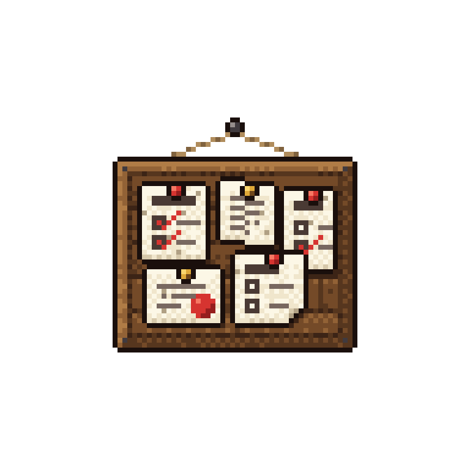

# Settings reference

[README](../README.md) · [Getting started](getting-started.md) · [Block reference](blocks.md)

Each repo in **Settings › Notes repos** has these fields. Paths are inside the repo's **Folder** (or the whole repo when it's empty). The second column is the same setting's name in an invite link.

| Field | In a link | What it does | Example |
|---|---|---|---|
| Name shown | `label` | What the repo is called in the list at the top of the files. Empty: `owner/repo`. | `My notes` |
| Owner | `owner` | The GitHub user or organization the repo belongs to. | `ann-example` |
| Repo | `repo` | The repo's name. | `notes` |
| Branch | `branch` | The branch the app reads and saves to. Empty: `main`. | `main` |
| Folder | `folder` | Show only this folder of the repo. Empty: the whole repo. | `notes` |
| Start page | `home` | The note that opens first. | `Home.md` |
| Inbox page | `inbox` | A note for quick notes and tasks. It gets an Inbox button and shortcut. Empty: no button. | `Notes/Inbox.md` |
| Inboxes folder | `inboxes` | A folder with one inbox per person. The Inbox button opens the one whose `github` property is your login. | `Notes/Inboxes` |
| New notes folder | `notes` | New note asks only for a title and puts the note here. Empty: you pick the name, kind (note or CSV) and folder each time. | `Notes` |
| Note template | `template` | A note that new Markdown notes start from. `{{title}}` becomes the title and `{{date}}` today's date (YYYY-MM-DD). Empty, or the file isn't there: a new note starts with `# Title`. | `Templates/Note.md` |
| Attachments folder | `attachments` | Added images go here, inside the vault. Leave empty to save them next to the note. | `Attachments` |
| Vault rules | `vault=1` | The generated navigation box (between `%% nav: … %%` and `%% /nav %%`) shows folded and can't be edited, links that lead to no page are warned about, and a new note's title must not already be a page anywhere. | on |

A local vault has only Name shown and the fields from Start page down: it has no owner, repo, branch or folder, and no invite link.

Settings live in this browser's storage, so each device has its own. An invite link copies them to another device, and so does a repo's `.commonplace.json` (see [Sharing](collaboration.md#sharing)).


### Task fields



A task is a note in the tasks folder (`Tasks/` unless you change it), and its fields are properties in its front matter. In **Settings**, open the repo and press **Task fields**:

- **Tick fields on and off.** The ones the app knows: Status, Priority, Assignee, Area, Requested by, Reviewer, Type (Epic, Story, Task, Bug), Parent task, the four relations (Blocked by, Related, Comes after, Comes before), Sprint, Estimate and Due date. A repo with no setup has the first five, as before; a new setup starts with all of them on but Reviewer, the person who checks and approves the work, which a project turns on if it wants one. A new task's reviewer is who asked for it (its Requested by), else whoever makes it, and can be changed.
- **Change the lists** (statuses, priorities, types), the **property** each field is kept in (the parent task is `part_of`, since `parent` places a page in the vault's tree), the sprints folder and length, and the estimate's unit (points, hours or days).
- **Add a field of your own:** a name, its property, and its kind: text, number, date, a choice from a list, a person or a link to a page.
- **Save to the repo** writes it into the repo's `.commonplace.json`, under `tasks`, in one commit. Everyone on the project shares it, and **Share with everyone** keeps it:

  ```json
  {
    "label": "Our notes",
    "tasks": {
      "folder": "Tasks",
      "fields": {
        "status": { "on": true, "values": ["To Do", "In Progress", "Waiting", "Done"] },
        "part_of": { "on": true },
        "sprint": { "on": true, "folder": "Sprints", "length_days": 14 },
        "estimate": { "on": true, "unit": "points" },
        "due": { "on": false }
      },
      "custom": [{ "name": "Component", "prop": "component", "kind": "choice", "values": ["App", "Docs"] }]
    }
  }
  ```

**On a task's page**, the fields that are on show as pickers and boxes above its other properties (a list for choices, a date picker, a number, a page name for parent task, sprint and links). A change is saved at once: one line in one commit. If the note has unsaved edits, the field changes with them and **Save** keeps both. A new note in the tasks folder starts with every field that's on, once a setup is saved.

**AI work history:** reserve `work_time` for AI-only whole minutes. An `ai-work-time` fenced block with `group: area-type` draws average minutes by area and type (`area` or `type` also work), sample counts and observed ranges. Only completed tasks in the current vault count; cancelled tasks, epics and invalid values are excluded. On unfinished tasks a read-only **AI time estimate** beside the fields uses the same area and type, labels one sample provisional and leaves the manual estimate unchanged. No AI call, no measurement of people. See [Set up tasks](../example-vault/Set%20up%20tasks.md#ai-work-history).

**A link to the setup:** any note can link to `#/settings?fields`, which opens Task fields for the repo you're in, e.g. `[Set up task fields](#/settings?fields)`. The example vault's [Set up tasks](../example-vault/Set%20up%20tasks.md) page does, and its Task Board links to it.

**Boxes are blocks in the note:** a task's Subtasks, Relations and Commits boxes, and a sprint's Sprint box, show where the note has a block for them, so nothing shows that the note doesn't ask for:

````markdown
```subtasks
```
````

- The blocks are ` ```subtasks `, ` ```relations `, ` ```commits ` and ` ```sprint `. Move a block to move its box; take it out and the box goes.
- A blank task starts with Subtasks, Relations, Description, Acceptance Criteria, Comments, Commits and Work History in that order. A custom template can place its own boxes. A new sprint gets `sprint`.
- Write the task's Markdown in `description`, `acceptance-criteria`, `comments` and `work-history` blocks. Criteria checkboxes save with the note. Work History starts folded at the bottom. A `comments` block works on any note. Write and post from the box, with an editable `@login` for the previous commenter when their login is known and differs from yours. Type `@` to pick anyone with an inbox. See [Work with tasks](../example-vault/How%20To/Work%20with%20tasks.md#task-sections).
- **Another task's box, on any page:** a `task:` line in a ` ```subtasks `, ` ```relations ` or ` ```commits ` block (the task's ID, name or `[[link]]`) shows that task's box there, naming it; away from the task's own page it only reads. The example vault's Task Board shows its epic's subtasks this way.
- **A sprint's box, on any page:** a `sprint:` line in a ` ```sprint ` block shows that sprint's box there, naming it: `current` (the one going on today), `next`, or a sprint's name or `[[link]]`. When there's none it says so; **Start the next sprint** stays on the sprint's own page. The example vault's Home shows the current sprint this way.
- In other Markdown editors, blocks show their source. To show a task or sprint box on another page in Commonplace.md, give it a `task:` or `sprint:` line.

**Parent tasks and subtasks:** a task's parent is in its `part_of` property (or the property the setup names), as a link: `part_of: "[[Get set up]]"`.

- A task with subtasks lists them on its page, each with its status, under a bar of how many are done (*Done*, *Cancelled*, *Won't do* and the last status in your list count as done).
- **Add subtask** on a task makes a new task in the tasks folder, linked to it, with its area and sprint, and opens it.

**Relations:** a task can link other tasks as **Blocked by** (`blocked_by`), **Related** (`related`), **Comes after** (`after`) and **Comes before** (`before`), each a list of links: `blocked_by: ["[[Get set up]]"]` (other Markdown editors show plain links).

- A task's **Relations** box shows them both ways, each task with its status: its own links, and the other tasks' links to it, the other way round (a task blocked by B shows on B under *Blocks*; one that comes after B shows on B under *Comes before*).
- **Add relation** picks how they're related and the other task, by its ID or name; the x by one of the task's own links takes it out. Each is one commit of that one line.
- A task blocked by a task that isn't done isn't suggested in the top tasks; it is again once that task is done.
- The parent picker lists the tasks by ID and name (type either). A task can't be its own parent, or sit under one of its own subtasks.
- On the board, a base can group by the parent: the example vault's *By parent* view does (`groupBy: part_of`).

**Commits:** a task lists the commits in its `commits` property, the newest first, each linking to GitHub. The example vault's *Get set up* has two. The app reads them from the note, so it asks GitHub for nothing.

A GitHub Action fills them in by itself. After each push, it adds every commit whose message starts with a task's ID (`T-6: ...`, or `T-5, T-6: ...` for several tasks) to that task, as one line: `"[abc1234](https://github.com/you/notes/commit/...) T-6: the first line"`. To set it up in the repo that holds your vault:

1. Copy [`tools/task-commits/task-commits.yml`](../tools/task-commits/task-commits.yml) to `.github/workflows/task-commits.yml`, with your vault's branch in it, and [`tools/task-commits/task_commits.py`](../tools/task-commits/task_commits.py) to `.github/task_commits.py`.
2. To fill in the tasks you already have, run `python .github/task_commits.py --all` once at the repo's root, then commit.

- It adds its own commit after each push that has a task's ID, so pull before your next push.
- Commits made from the app (a save, a claim, a field change) are left out, and so is a push made only of them: those cost no Actions minutes.
- It sees the repo it runs in. Commits in other repos can still go in by hand, as a line like the ones above or a bare commit address.

**Sprints:** a sprint is a note in the sprints folder (`Sprints/` unless the setup says otherwise) with `start`, `end` and `goal`; a task joins it with `sprint: "[[Sprint 12]]"`.

- A sprint's page lists its tasks by status, with how many are done and, when estimates are on, how much of the estimate.
- The sprint picker on a task offers the current sprint first, then the next one.
- **A new task** (a new note in the tasks folder) goes on the next sprint, if there is one, so the current sprint's plan stays as agreed; change it in its Sprint field. **Add subtask** gives it its parent's sprint instead, when the parent has one.
- **Start the next sprint** (on the latest sprint) makes the next note, its name counted on and its dates from the setup's length, and moves the unfinished tasks you keep ticked: one commit for all of it.
- A base can show the sprint going on today with `start <= today()` and `end >= today()`: the example vault's *Current sprint* view.
