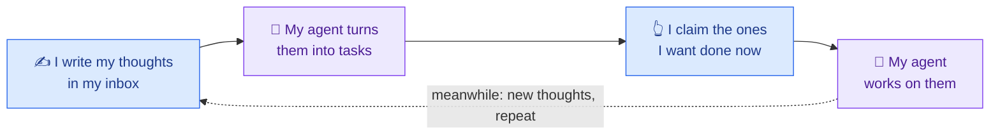

# Using Commonplace.md

[README](../README.md) · [Getting started](getting-started.md) · [Block reference](blocks.md)

## How to use it


- 🗂️ **Your vault for everything**: a project's wiki, your own notes, your recipes.
- 🤖 **Your agents' rules and reports** live in the project, as notes you own.
- ✅ **A task board** for you and your agent, or a whole team.
- 🛠️ **Yours to change**: the rules, skills, task fields and code. Choose the views a note shows through its blocks and properties ([block reference](blocks.md); [Markdown examples](markdown-and-blocks.md)).
- 🆓 **Free, and only yours**: no account of ours, no payments. You need only GitHub and a token you make.

### How I use it



<sub>🟦 you &nbsp; 🟪 your agent</sub>

### Not sure it's for you?

Ask your AI agent whether it would help you:

```text
Read the README of Commonplace.md: https://github.com/Snowy-Peak-Studios/commonplace-md
It's a free notes app: a wiki, notes and a task board, kept as Markdown files in my own GitHub repo,
made to be used by people and AI agents together.
Ask me a few short questions about how I work, what I keep notes on and which AI agents I use.
Then tell me plainly whether it would help me, what I'd use it for, and what it would cost me in time.
Don't set anything up yet.
```

## Why

I was frustrated with the work tools I had to use, so I started making this for my own daily use. It grew until it became my main focus. Now I'm sharing it with everyone who has struggled with those tools like I did.

## What it does

- Your notes are plain Markdown files in your own GitHub repo or locally on your PC.
- Read and edit them on a computer or a phone, and install it as an app.
- **Export as PDF:** open a note, then **More (⋯) › Export as PDF**. Choose **Save as PDF** in the browser's print dialog (on phones, use the available Print/share option). It prints a light copy with folded sections open and app controls hidden; cancelling keeps your note and drafts as they were.
- Wikilinks, embeds, callouts, diagrams, checklists, and tables of your notes from `.base` files.
- Inboxes, invite links and read-only mode for working as a team, and rules for AI agents if you like.
- Free: no server, no account of ours, nothing to install.

- **Local vaults:** a vault only on this device, with no GitHub at all: a new folder in a place you pick, or a folder of notes you already have, opened as it is (Chrome and Edge: real `.md` files your agent can change too), or kept in the browser elsewhere, with **Download a copy** as a zip ([more](getting-started.md#a-local-vault)).
- **Offline:** every GitHub vault is kept on the device too, so it opens with no connection (a line above the note says it's the copy). The copy is kept in the browser, or (Chrome and Edge on a computer) in a folder you pick, like the repo's clone, so other tools and agents read the same files and each commit updates them ([more](getting-started.md#a-copy-on-this-device)).
- **Up to date:** a Reload button beside Save, and a quiet banner when GitHub has newer notes than the ones you have open (checked when you come back to the tab and every few minutes, cheaply).
- **Files:** a folder tree of the chosen repo, a Back button (also in the installed app, which has no browser buttons), an Up button to the note's `parent` page, shortcuts to the Inbox and start page, recent files, a file-name filter, and a search inside notes (GitHub's code search).
- **Markdown:**
  - Read and Edit modes. On a wide screen, Edit shows the preview beside the editor (CodeMirror 6).
  - `[[Wikilinks]]` work, with headings and aliases. A bare name finds the page in any folder.
  - `![[image.png]]` embeds show, and so do callouts and the front matter as properties. In **Edit**, paste or drop an image, or use **Add image** in the top bar on a phone.
  - ` ```mermaid ` blocks are drawn as diagrams (flowcharts and the rest), in the light or dark scheme.
  - A ` ```top-tasks ` block shows the top tasks to start on any page, an inbox too, with everything it shows written in the block.
  - `@login` mentions a person (typing `@` offers everyone with an inbox).
  - A ` ```new-tasks ` block catches ideas on any page, with an **Add** field, and each item can be changed or taken out right in the box; your agent finds every one in the vault and turns them into tasks.
  - A ` ```needs-attention ` block shows what waits on you: the tasks with a question for you, and the places that mention you, in one box or two.
  - `![[Page]]` and `![[Page#Heading]]` show that page, or that heading's section, inside the note.
  - Checkboxes can be ticked in Read mode.
  - A point with subpoints (bullets, numbers or checkboxes) has an arrow in Read mode that folds them away; only the view changes, never the note.
- **Base views:** `.base` files show as tables, embedded with `![[X.base]]` or opened from the tree. A ` ```base ` block writes a view right in the page, with what a `.base` file holds, and shows the same table. Their views are tabs, with filters, sorting, groups and formulas (with `if()`, `today()` and `date()`); "Last modified" is the date of the note's last commit.
- **CSV and TSV:** opens as an editable table (add or delete rows and columns) or as text, and saves back as it was: quotes, line breaks in cells, `,` `;` or tab separators, Excel's byte order mark and `sep=` line. A big table shows 500 rows at a time.
- **Other files:** JSON, YAML, TOML, HTML, CSS, JavaScript, Python, shell and other code open as text with colours, any other text file as plain text. PDFs show in the page on a computer, with **Open in a new tab** and **Download** everywhere. Anything else (audio, video, Word, Excel, archives) offers a **Download**.
- **Saving:** one commit per save. If the file changed on GitHub in the meantime, GitHub refuses the save and the app shows both versions side by side, so nothing is overwritten.
- **Drafts:** unsaved changes stay in the browser and are offered back after the page closes. Leaving a note with unsaved changes asks first: **Save**, **Keep as a draft** or **Discard** (or **Stay**).
- **New notes:** pick a name, kind and folder, or set a repo's New notes folder and Note template so a new note needs only a title.
- **An app of its own:** installs on a computer or a phone, with its own window and icon ([how](getting-started.md#5-install-it-as-an-app-optional)). Works at phone width, and with no connection: notes saved offline go to GitHub when it's back.
- **Look:** light and dark, following the device.
- **The files sidebar:** on a computer, drag its right edge to make it wider or narrower (or focus the edge and use the arrow keys; a double-click or Home gives the usual width), and hide or show it with the panel button at the top left. This device remembers both. On a phone the files open over the note.
- **Copy a page's link or path:** right-click the page's name at the top (a long press on a phone, or focus it and press Enter or the menu key) for **Copy link** (opens the page in the app, where the vault is set up), **Copy GitHub link** (the file on GitHub, for a GitHub vault) and **Copy file path** (its path in the repo or folder, for a terminal or an AI agent).
- **Keys:** Ctrl+S saves, Ctrl+E switches between Read and Edit, Ctrl+K searches the files.
- **Vault rules (optional, per repo):** a generated navigation box shows folded and can't be edited, and a link to no page is warned about.
- **Task fields per project:** turn task fields on and off (status, priority, assignee, type, parent task, relations, sprint, estimate, due date), change their lists and property names, and add fields of your own; kept in the repo, so the whole team shares them ([more](settings.md#task-fields)).
- **Subtasks:** a task lists the tasks under it with their status and a progress bar, and **Add subtask** makes a new one under it.
- **Relations:** a task can be *blocked by*, *related to*, or *come after* or *before* other tasks; each shows on both tasks, and a task blocked by an open one isn't suggested.
- **Commits:** a task lists the commits made for it, each linking to GitHub; a GitHub Action adds every commit whose message starts with the task's ID ([more](settings.md#task-fields)).
- **Sprints:** a sprint's page lists its tasks by status with how much is done, and **Start the next sprint** moves what's left into the next one.
- **Optional inbox overview:** off by default in Settings → This device. Select vaults and per-vault identities in a private browser-local dashboard; **All inboxes** shows source-labelled reviews, questions, assignments, mentions and captures. Open an item to act in its source. Manual refresh, per-source access/offline states, no source writes or global capture. The dashboard needs its own backup and setup on each device. [Set it up](../example-vault/How%20To/Use%20your%20inbox.md#one-overview-of-selected-inboxes).
- **Inboxes:** an Inbox button opens your own inbox. Needs attention can show **For review** first with `show: reviews`: tasks in Testing for the named reviewer, falling back to the assignee when no reviewer is declared. Use `review-statuses:` for custom review states. Reviews stay until the task leaves that state, and are not dismissed with Seen. **Tasks for today** keeps the existing `top-tasks` block and its Claim action. A dot says something waits on you.
- **AI agents (optional):** rules and step-by-step skills in the example vault for agents that sort your inbox into tasks, work on them and keep the board up to date ([more](ai-agents.md#working-with-ai-agents-optional)). A declared sibling registry can route an item to another authorized vault: the agent verifies the saved destination task before clearing the source ([how](../example-vault/How%20To/Use%20your%20inbox.md#an-item-for-another-vault)).
- **Sharing:** invite links that set up a repo on someone else's device; a `.commonplace.json` in a repo that adds it by itself for everyone who can save to it; read-only mode for people who can't push.


**What's next:** the [roadmap](../ROADMAP.md) shows what we're working on now and what comes after.
