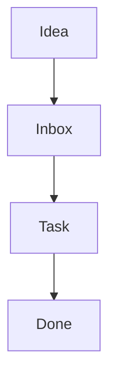

%% nav: made by a script, don't edit it by hand %%
> [!abstract]+ 🧭 [[Home]] › Guide
>
> **On this page**
> - [[#Links|Links]]
> - [[#Embeds|Embeds]]
> - [[#Callouts|Callouts]]
> - [[#Checkboxes|Checkboxes]]
> - [[#Diagrams|Diagrams]]
> - [[#The navigation box|The navigation box]]
%% /nav %%

# Guide

What a note can hold. Open this page in Edit mode to see how each part is written.

## Links

- A plain link: [[Task Board]]
- A link to a heading: [[Task Board#Current goals]]
- A link with its own text: [[Notes/Inbox|the shared inbox]]
- A link to a heading, with its own text: [[Home#How saving works|how saving works]]
- A bare name finds the page in any folder: [[Make a note template]]
- Normal Markdown links work too: [the Markdown guide](https://commonmark.org/help/)

## Embeds

An image from `Attachments/`, 120 pixels wide:

![[commonplace.svg|120]]

A section of another page:

![[Home#Where things are]]

## Callouts

> [!note] A note
> Callouts are blockquotes that start with `[!kind]`.

> [!warning]- A folded warning
> Add `-` after the kind to fold it, `+` to show it open.

## Checkboxes

Tick them in Read mode; each tick is saved as a commit.

- [x] Copy the example vault into a repo
- [x] Make a token
- [ ] Add the repo in Settings
- [ ] Write a first note

## Diagrams

A small one:

A wide one, which scrolls sideways on a phone:

## The navigation box

The box at the top of this page, between `%% nav: ... %%` and `%% /nav %%`, is made by a script you run yourself (any script that writes that block will do). With the repo's **Vault rules** setting on, the app shows it folded and won't let you edit it, so the script stays in charge of it.
