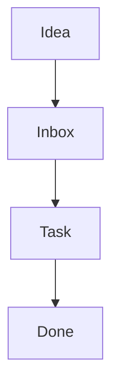
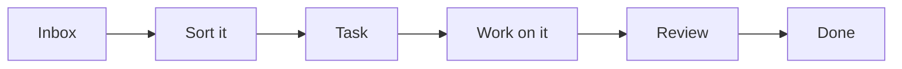

%% nav: made by a script, don't edit it by hand %%
> [!abstract]+ 🧭 [[Home]] › Guide
>
> **On this page**
> - [[#Links|Links]]
> - [[#Embeds|Embeds]]
> - [[#Callouts|Callouts]]
> - [[#Checkboxes|Checkboxes]]
> - [[#Lists with subpoints|Lists with subpoints]]
> - [[#Diagrams|Diagrams]]
> - [[#The navigation box|The navigation box]]
%% /nav %%

# Guide

What a note can hold. Open this page in Edit mode to see how each part is written.

## Links

- A plain link: [[Task Board]]
- A link to a heading: [[Task Board#Current goals]]
- A link with its own text: [[Notes/Inbox|the shared inbox]]
- A link to a heading, with its own text: [[Home#How saving works|how saving works]]
- A bare name finds the page in any folder: [[Make a note template]]
- Normal Markdown links work too: [the Markdown guide](https://commonmark.org/help/)

## Mentions

Write `@` and someone's GitHub login to mention them: @your-github-login, have a look at this part. In Edit mode, typing `@` offers everyone who has an inbox. A mention is a link to their inbox, and the ` ```needs-attention ` block at the top of their [[Inbox]] lists every place that mentions them, this line too. In code, like `@this`, and in an email address it isn't a mention. A reply on the very next line, starting with `@` and their login, clears it from their box; so does their **Seen** button.

## New tasks anywhere

A ` ```new-tasks ` block catches ideas right where you have them, on any page: write one per line, or use **Add** in the box; the pencil beside an item changes it, and the cross takes it out. Its `owner:` says whose they are; their agent finds every such block in the vault and turns each item into a task.

```new-tasks
owner: Your name
- Show the reading list on the Home page
```

## Embeds

An image from `Attachments/`, 120 pixels wide:

![[commonplace.svg|120]]

A section of another page:

![[Home#Where things are]]

## Callouts

> [!note] A note
> Callouts are blockquotes that start with `[!kind]`.

> [!warning]- A folded warning
> Add `-` after the kind to fold it, `+` to show it open.

## Checkboxes

Tick them in Read mode; each tick is saved as a commit.

- [x] Copy the example vault into a repo
- [x] Make a token
- [ ] Add the repo in Settings
- [ ] Write a first note

## Lists with subpoints

In Read mode, a point with subpoints has a small arrow: tap it to fold them all away, and again to show them. It only changes what you see, never the note.

- Plan the week
  - Monday: sort the inbox
  - Friday: look back
    - What got done
    - What moves to next week
- Pack for the trip
  - Tickets
  - Charger

1. Make the repo
   1. Pick a name
   2. Keep it private
2. Add it in Settings

- [ ] Share the notes
  - [ ] Copy the invite link
  - [ ] Send it to a friend

## Diagrams

A small one:



A wide one, which scrolls sideways on a phone:



## The navigation box

The box at the top of this page, between `%% nav: ... %%` and `%% /nav %%`, is made by a script you run yourself (any script that writes that block will do). With the repo's **Vault rules** setting on, the app shows it folded and won't let you edit it, so the script stays in charge of it.
