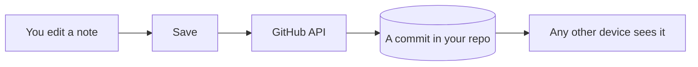

# Home

Welcome to your notes. This folder is an example vault for **Commonplace.md**: copy it into your own GitHub repo, open it in the app, and change anything you like. It's plain Markdown, so it also opens in any Markdown editor as it is.

Use it for everything that makes your life and work easier: your notes and wiki, your AI agents' rules and reports, and a task board for you, your agent or your team. The [[How To]] pages show how.

> [!tip] Start here
> Read the [[Guide]] for what a note can hold, look at the [[Task Board]], or drop a thought in the [[Inbox]].

## Where things are

| Page | What it holds |
|---|---|
| [[Guide]] | Links, embeds, callouts, checkboxes, folding lists, diagrams and the navigation box |
| [[Task Board]] | The tasks in `Tasks/`, shown as a table from [[Tasks.base]] |
| [[Set up tasks]] | Which fields your tasks have: [set them up](#/settings?fields) for the whole project |
| [[How To]] | Short steps for each thing you do here: connect, add a vault, invite someone, tasks, sprints, the inbox, saving, the phone |
| [[Inbox]] | Quick notes, new tasks and questions; each person can have their own in `Notes/Inboxes/` |
| [[Reading list.csv\|Reading list]] | A CSV file, opened as a table you can edit |
| [[Other kinds of files]] | Tables, JSON, scripts, PDFs and pictures: what opens how |
| [[AGENTS\|Rules for AI agents]] | Optional: how AI agents work in these notes (`AGENTS.md`, loaded by `CLAUDE.md`); the prompt to start one is [[#Working with an AI agent\|below]] |

## This week's goals

The goals live on the Task Board; this is that section, embedded here:

![[Task Board#Current goals]]

## This sprint

The sprint going on today, with its tasks by status: a ` ```sprint ` block with `sprint: current`. It can also say `next`, or a sprint's name or link; without the line it only works on a sprint's own page.

```sprint
sprint: current
```

## Tasks for today

The same top tasks your [[Inbox]] shows, on this page: a ` ```top-tasks ` block. Everything it shows is written in it, one option per line:

- `range:` how many tasks (up to 20);
- `areas:` only these areas (empty: every area);
- `order:` `priority-newest` (High, Medium, Low, the newest first within each), `priority-oldest`, `newest` or `oldest` (priority not counted);
- `sprint:` `current-only`, `current-then-next` (the next sprint's when the current one has none left), or `off` (every task);
- `owner:` whom **Claim** claims a task for;
- `fields:` what each task shows besides its name and **Claim**, in that order: `parent` (the task it's part of), `state` (*Ready*, *Needs a decision*, ...), `priority`, `area`, or any other property. Left out: `state, priority, area`.

Nothing is taken from anywhere else. Other Markdown editors show it as a small code block.

```top-tasks
range: 3
areas:
order: priority-newest
sprint: current-then-next
owner: Your name
fields: parent, state, priority, area
```

## Done so far

A table of notes written right in this page: a ` ```base ` block holds what a `.base` file would (its filters, columns and views), so a page can have a view of its own without a file next to it. Copy a view between a block and a file as it is.

```base
filters:
  and:
    - file.inFolder("Tasks")
    - status == "Done"
properties:
  file.name:
    displayName: Task
  assignee:
    displayName: Done by
views:
  - type: table
    name: Done tasks
    order:
      - file.name
      - assignee
```

## How saving works



## Working with an AI agent

Optional. An agent that can run git (Claude Code, Codex and others) follows [[AGENTS|the rules for AI agents]]: it reads the goals and your inbox, turns your notes into tasks, and asks you under *Needs attention* when it needs you. Set its git `user.name` to the `owner` of your inbox, open it in this repo and paste:

```text
Read AGENTS.md and follow it: pull, read the current goals and my inbox, and sort my new tasks into
task notes. Then tell me which task you'd pick next and why, and wait for my go-ahead before you start it.
```

![[commonplace.svg|160]]
