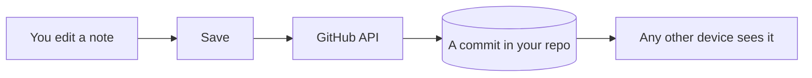

# Home

Welcome to your notes. This folder is an example vault for **Commonplace.md**: copy it into your own GitHub repo, open it in the app, and change anything you like. It's plain Markdown, so it also opens in any Markdown editor as it is.

> [!tip] Start here
> Read the [[Guide]] for what a note can hold, look at the [[Task Board]], or drop a thought in the [[Inbox]].

## Where things are

| Page | What it holds |
|---|---|
| [[Guide]] | Links, embeds, callouts, checkboxes, diagrams and the navigation box |
| [[Task Board]] | The tasks in `Tasks/`, shown as a table from [[Tasks.base]] |
| [[Inbox]] | Quick notes and new tasks; each person can have their own in `Notes/Inboxes/` |
| [[Reading list.csv\|Reading list]] | A CSV file, opened as a table you can edit |

## This week's goals

The goals live on the Task Board; this is that section, embedded here:

![[Task Board#Current goals]]

## How saving works

![[commonplace.svg|160]]
