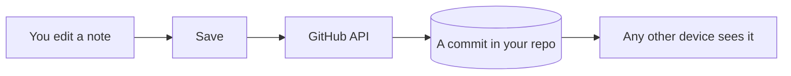

# Home

Welcome to your notes. This folder is an example vault for **Commonplace.md**: copy it into your own GitHub repo, open it in the app, and change anything you like. It's plain Markdown, so it also opens in any Markdown editor as it is.

> [!tip] Start here
> Read the [[Guide]] for what a note can hold, look at the [[Task Board]], or drop a thought in the [[Inbox]].

## Where things are

| Page | What it holds |
|---|---|
| [[Guide]] | Links, embeds, callouts, checkboxes, folding lists, diagrams and the navigation box |
| [[Task Board]] | The tasks in `Tasks/`, shown as a table from [[Tasks.base]] |
| [[Set up tasks]] | Which fields your tasks have: [set them up](#/settings?fields) for the whole project |
| [[Inbox]] | Quick notes, new tasks and questions; each person can have their own in `Notes/Inboxes/` |
| [[Reading list.csv\|Reading list]] | A CSV file, opened as a table you can edit |
| [[Other kinds of files]] | Tables, JSON, scripts, PDFs and pictures: what opens how |
| [[AGENTS\|Rules for AI agents]] | Optional: how AI agents work in these notes (`AGENTS.md`, loaded by `CLAUDE.md`); the prompt to start one is [[#Working with an AI agent\|below]] |

## This week's goals

The goals live on the Task Board; this is that section, embedded here:

![[Task Board#Current goals]]

## What to start next

The same top tasks your [[Inbox]] shows, on this page: a ` ```top-tasks ` block. Everything it shows is written in it, one option per line:

- `range:` how many tasks (up to 20);
- `areas:` only these areas (empty: every area);
- `sprint:` `current-only`, `current-then-next` (the next sprint's when the current one has none left), or `off` (every task);
- `owner:` whom **Claim** claims a task for.

Nothing is taken from anywhere else. Other Markdown editors show it as a small code block.

```top-tasks
range: 3
areas:
sprint: current-then-next
owner: Your name
```

## How saving works



## Working with an AI agent

Optional. An agent that can run git (Claude Code, Codex and others) follows [[AGENTS|the rules for AI agents]]: it reads the goals and your inbox, turns your notes into tasks, and asks you under *Needs attention* when it needs you. Set its git `user.name` to the `owner` of your inbox, open it in this repo and paste:

```text
Read AGENTS.md and follow it: pull, read the current goals and my inbox, and sort my new tasks into
task notes. Then tell me which task you'd pick next and why, and wait for my go-ahead before you start it.
```

![[commonplace.svg|160]]
