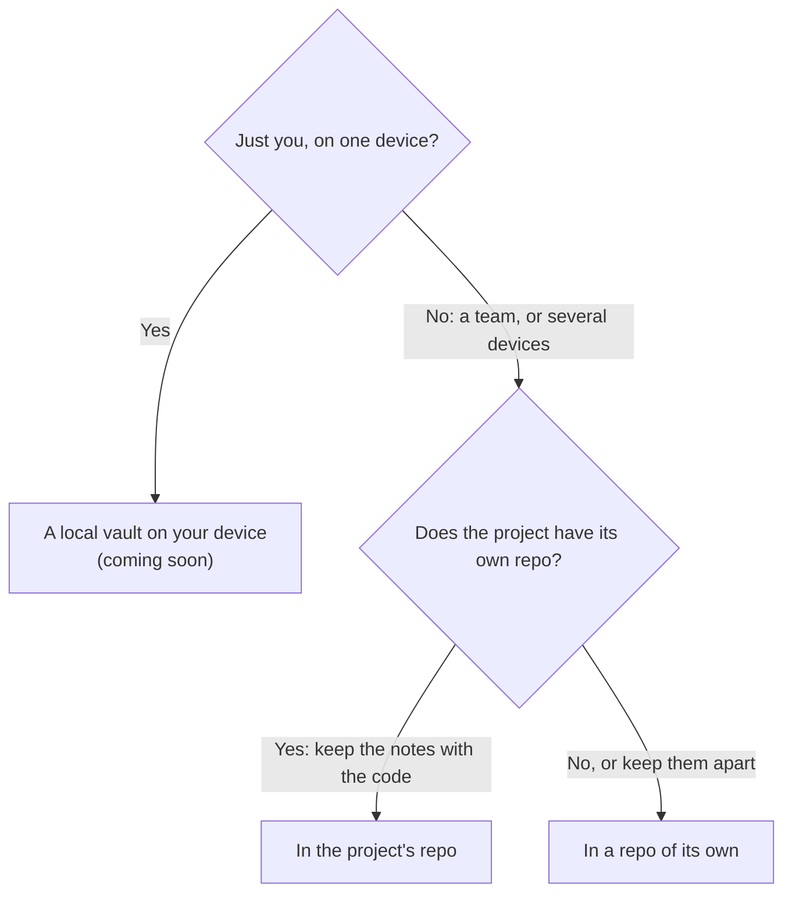

# How To

> **tl;dr:** Pick your way below, then follow the steps for each thing you do, one short page each.

Don't rely on your agent's memory: make your own vault with all the answers. These pages show how.

Short steps for the things people do in Commonplace.md, one page each. They read the same on GitHub and in the app: the links between them are plain Markdown links, which both follow.

## Which way fits you

The app is the same for everyone. What you pick is where your vault lives:

- **Just you, on one device**: a local vault, with no GitHub account and no token, only the app. *Coming soon*; until then, use a repo of its own (it can be private).
- **A team, or several devices**: the vault is in a GitHub repo, and every device and person syncs through it:
  - **In the project's repo**, in a folder next to the code: one repo, and your agent sees both. Whoever can see the code sees the notes.
  - **In a repo of its own**: private notes even for a public project, and room for several projects.

More on each, with what it costs: [the README](https://github.com/Snowy-Peak-Studios/commonplace-md#which-way-fits-you).

## Getting started

1. [Connect to GitHub](Connect%20to%20GitHub.md): make a token and paste it.
2. [Add a vault](Add%20a%20vault.md): open a notes repo in the app.
3. [Use it on a phone](Use%20it%20on%20a%20phone.md): install it as an app.

## Every day

- [Write and link notes](Write%20and%20link%20notes.md)
- [Save, drafts and conflicts](Save%2C%20drafts%20and%20conflicts.md)
- [Use your inbox](Use%20your%20inbox.md), and its top tasks to start

## Tasks and teams

- [Work with tasks](Work%20with%20tasks.md): fields, subtasks, relations and commits
- [Run sprints](Run%20sprints.md)
- [Invite someone](Invite%20someone.md)
- [Set up tasks](../Set%20up%20tasks.md): which fields your tasks have

## More

- [The guide](../Guide.md): everything a note can hold.
- [Rules for AI agents](../AGENTS.md): how an AI agent works in these notes.
