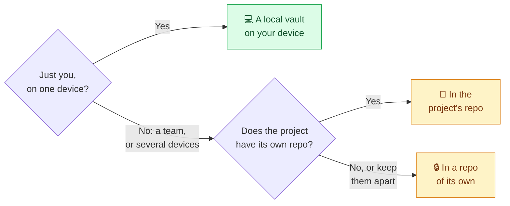

# How To

> [!TIP]
> **tl;dr:** Pick your way below, then follow the short steps for each thing you do.

*Don't rely on your agent's memory: make your own vault with all the answers.* These pages show how, one short page for each thing you do in **Commonplace.md**. They read the same on GitHub and in the app.

## Which way fits you

The app is the same for everyone. What you pick is where your vault lives:

- 🟩 **Just you, on one device**: a local vault, with no GitHub account, only the app.
- 🟨 **A team, or several devices**: the vault in a GitHub repo, **the project's own** (next to the code) or **one of its own** (private, even for a public project).

More on each, with what it costs: [the README](https://github.com/Snowy-Peak-Studios/commonplace-md#which-way-fits-you).

## Try a starter vault

Pick the one closest to what you do. Follow the [local vault steps](Add%20a%20vault.md#only-on-this-device), then select **An example vault** under **Start with**.

- **Solo project · Trail Timer** follows one person building a small app with an agent.
- **Small team · Pocket Garden** gives three people their own inboxes and a shared task board.
- **Large team · Signal Station** shows a ten-person team planning a demo across epics and sprints.
- **Personal notes · Kitchen Notebook** keeps recipes, meals and shopping in one place.

Each opens on its Home page. Edit the notes to make it yours, or use **Download a copy** to keep a ZIP.

## Getting started

1. [Connect to GitHub](Connect%20to%20GitHub.md): make a token and paste it.
2. [Add a vault](Add%20a%20vault.md): open a notes repo in the app.
3. [Use it on a phone](Use%20it%20on%20a%20phone.md): install it as an app.

## Every day

- [Write and link notes](Write%20and%20link%20notes.md)
- [Markdown and blocks](Markdown%20and%20blocks.md) shows what to write and how it looks in the app.
- [Save, drafts and conflicts](Save%2C%20drafts%20and%20conflicts.md)
- [Use your inbox](Use%20your%20inbox.md), and its top tasks to start

## Tasks and teams

- [Work with tasks](Work%20with%20tasks.md): fields, subtasks, relations and commits
- [Run sprints](Run%20sprints.md)
- [Invite someone](Invite%20someone.md)
- [Set up tasks](../Set%20up%20tasks.md): which fields your tasks have

## More

- [The guide](../Guide.md): everything a note can hold.
- [Rules for AI agents](../AGENTS.md): how an AI agent works in these notes.
- [Switch AI agents](Switch%20AI%20agents.md): the vault as your agents' memory, and a saved handoff.
