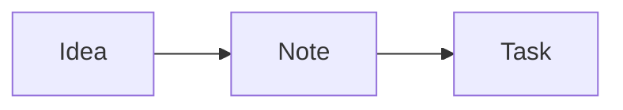

# Markdown and blocks

Use **Edit** to write Markdown and **Read** to see the result. The examples below use files and tasks in this example vault. Open this page in **Edit** to copy the live blocks. On GitHub, the Commonplace.md blocks show their source.

## Markdown basics

### Headings, text and lists

Write this:

~~~markdown
#### A heading

Use **bold**, *italic* and `inline code`.

- First item
  - A subpoint
- [ ] A checkbox

1. First step
2. Next step
~~~

You'll see:

#### A heading

Use **bold**, *italic* and `inline code`.

- First item
  - A subpoint
- [ ] A checkbox

1. First step
2. Next step

### Links, tables and callouts

Write this:

~~~markdown
[Home](../Home.md) or [[Home|this vault's Home]]

| Item | State |
| --- | --- |
| Notes | Ready |

> [!tip] A small tip
> Leave a blank line between paragraphs.
~~~

You'll see:

[Home](../Home.md) or [[Home|this vault's Home]]

| Item | State |
| --- | --- |
| Notes | Ready |

> [!tip] A small tip
> Leave a blank line between paragraphs.

Use `[[Home#Where things are]]` to open a heading. Add `!` before the link to show that section in your note, as in `![[Home#Where things are]]`. The [Guide](../Guide.md) has live examples of page and image embeds, foldable callouts and the navigation box.

### Code and properties

Put code between three backticks. A language name such as `js` lets the reader highlight the code.

~~~markdown
```js
const total = 2 + 3;
```
~~~

You'll see:

```js
const total = 2 + 3;
```

Put properties between two lines of three dashes at the very top of a note. This page starts with:

~~~yaml
---
parent: "[[How To]]"
tags: [guide]
---
~~~

Commonplace.md shows these values above the note. The parent puts this page under **How To** in the tree. Tasks and sprints use properties for fields such as `status`, `start` and `end`.

## Inbox blocks

### Tasks for today

A `top-tasks` block lists tasks you can start. Set `range` for how many, `areas` to filter by area, `order` to sort, `sprint` to select a sprint window, `owner` to choose who receives the task when it is claimed, and `fields` for the details to show. [Use your inbox](Use%20your%20inbox.md#tasks-for-today) lists the values for each line.

~~~markdown
```top-tasks
range: 2
order: priority-newest
sprint: off
owner: Your name
fields: state, priority, area
```
~~~

```top-tasks
range: 2
order: priority-newest
sprint: off
owner: Your name
fields: state, priority, area
```

### Needs attention

A `needs-attention` block lists questions for `owner` and mentions for the GitHub `login`. Set `show` to `questions`, `mentions`, or both. This example can find the question on [Add a reading list](../Tasks/Add%20a%20reading%20list.md) and a mention in the [Guide](../Guide.md#mentions).

~~~markdown
```needs-attention
show: questions, mentions
owner: Your name
login: your-github-login
```
~~~

```needs-attention
show: questions, mentions
owner: Your name
login: your-github-login
```

### New tasks

To include context, put the cursor on the intended idea in the multiline box and paste an image or file when the clipboard provides file data, or choose **Attach file** (desktop and phone). The file is saved in this vault's Attachments folder, or beside the inbox when none is configured. Its Markdown link is added to that line; pictures have a preview and other files keep a readable filename. Add or keep changes, then Save the note to keep the link. Files are limited to 10 MiB. A failed upload keeps your text and offers **Retry attachment**. When an agent turns the idea into a task, it carries the link into the new task note; the attachment stays in the vault after the capture is cleared.

A `new-tasks` block holds one idea per line. Set `owner` to the person whose agent should turn the items into task notes.

Use the multiline box to write or paste several ideas, one per line (bullets are optional), then press **Add**. **Enter** adds a line. **Edit list** puts all items in the same box so you can revise or delete several at once; each item also has Edit and Remove. Choose **Keep changes**, then **Save** the note. The block keeps its `owner:` line, and agents still read one idea per Markdown list item.

~~~markdown
```new-tasks
owner: Your name
- Add a book to the reading list
```
~~~

```new-tasks
owner: Your name
- Add a book to the reading list
```

### Optional inbox overview

This block runs only in the private browser-local dashboard selected in **Settings → This device**. This shared example stays inert and reads no source. Use [Set up inbox overview](Use%20your%20inbox.md#one-overview-of-selected-inboxes) to select exact vaults and identities privately.

~~~markdown
```inbox-overview
context: My inbox
show: [reviews, questions, assignments, mentions, new-tasks]
review-statuses: [Testing]
refresh: manual
limit: 50
sources: []
```
~~~

```inbox-overview
context: My inbox
show: [reviews, questions, assignments, mentions, new-tasks]
review-statuses: [Testing]
refresh: manual
limit: 50
sources: []
```

## Task and sprint blocks

### Subtasks, relations and commits

Leave the blocks empty on a task's own page. On any other page, add `task:` with a task name, ID or wikilink. The examples below show the children of **Get set up**, the links to and from **Add a reading list**, and the commits listed on **Get set up**. The boxes on this page are for reading. See [Work with tasks](Work%20with%20tasks.md) for editing a task.

The Relations box needs a relation field turned on. If it is missing, open [Task fields](#/settings?fields), turn on **Related** and **Comes after**, and choose **Save to the repo**. Then return here.

~~~markdown
```subtasks
task: Get set up
```

```relations
task: Add a reading list
```

```commits
task: Get set up
```
~~~

```subtasks
task: Get set up
```

```relations
task: Add a reading list
```

```commits
task: Get set up
```

### Task sections and comments

Use standalone `description`, `acceptance-criteria`, `comments` and `work-history` fences for the Markdown you write on a task. The history starts folded at the bottom. Post comments in Read mode on any note. The previous commenter's mention is filled in when their login is known and differs from yours. See [Work with tasks](Work%20with%20tasks.md#task-sections) for the four together or the [Guide](../Guide.md#comments) for a Comments block on a regular note.

### Sprint

Leave the `sprint` block empty on its own sprint note. On another page, set `sprint:` to a sprint name or wikilink, `current`, or `next`. A named sprint works even after its dates pass.

~~~markdown
```sprint
sprint: Sprint 1
```
~~~

```sprint
sprint: Sprint 1
```

## Diagrams and views

### Mermaid diagrams

In a `mermaid` block, `flowchart LR` makes a left-to-right diagram and `-->` draws an arrow.

~~~markdown

~~~


### Base views

A base makes a view of files and their properties. Use `filters` to choose files and `views` for the table and its columns. A `base` block keeps the setup on this page. The same lines can go in a `.base` file that other pages embed.

~~~markdown
```base
filters: 'file.inFolder("Tasks")'
views:
  - type: table
    name: Tasks
    order:
      - file.name
      - status
```
~~~

```base
filters: 'file.inFolder("Tasks")'
views:
  - type: table
    name: Tasks
    order:
      - file.name
      - status
```

To use a shared file, write `![[Bases/Tasks.base]]`. The [Task Board](../Task%20Board.md) shows that full view with its tabs.

## Contents and subpages

### A table of contents

A `toc` block lists the page's headings, each a link to its place, nested as they are on the page. `depth` is the smallest heading it shows: `2` for `##` only, up to `6`; without it, `##` and `###`. It follows the page as you change its headings.

~~~markdown
```toc
depth: 2
```
~~~

```toc
depth: 2
```

### Subpages

A `subpages` block lists the pages whose `parent` property leads to this page, with each page's `description` property after its name. Pages with an `order` number come first; the rest follow by name. `depth` shows the pages under those too, up to `3` levels. `page:` lists another page's subpages instead. Tasks aren't listed; the task board shows them.

~~~markdown
```subpages
page: "[[How To]]"
```
~~~

```subpages
page: "[[How To]]"
```
